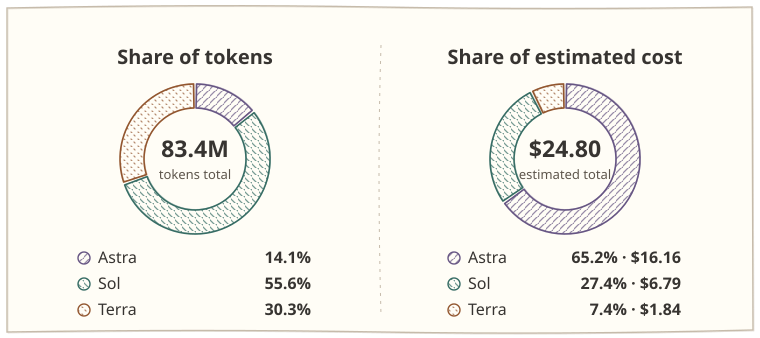
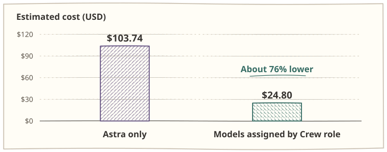
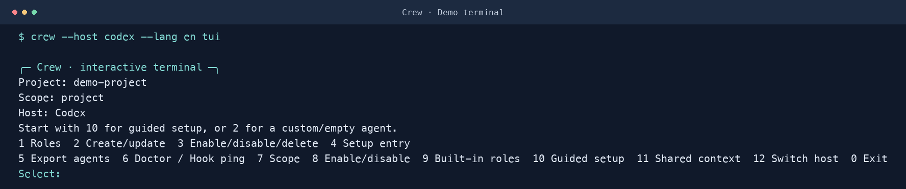
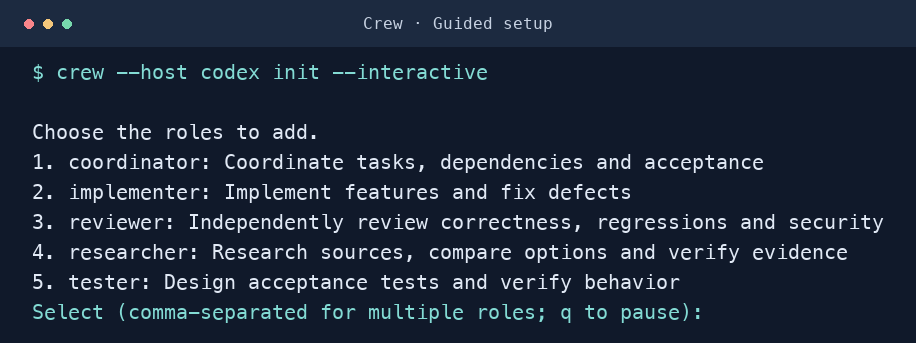
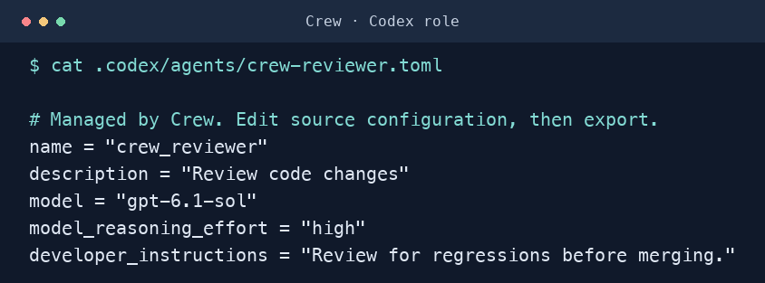

# Crew

**Give your Codex and Claude Code agents distinct roles.**

Choose a model, reasoning effort, and prompt for each role. Pass decisions and next steps between sessions through shared task state. Crew runs locally and is open source under the [MIT License](LICENSE).


[简体中文](README.md) · **English** · [Cookbook (简体中文)](docs/COOKBOOK.md)

## Why Crew?

- **Choose a model for each role.** Start with bilingual presets for coordination, implementation, review, research, and testing. Set the model and reasoning effort for each role, then preview the export.
- **Keep decisions across handoffs.** Sessions in the same host can read a shared task summary, constraints, decisions, and next steps. After the first snapshot, they can request changes by version to avoid resending the full task state.
- **Keep configuration local.** Use one CLI for Codex and Claude Code, with separate roles and task state for each host. Crew runs on the Python standard library.

### Token usage and cost in one coding task



Sol and Terra handled **85.9% of tokens** and accounted for **34.8% of the estimated cost**.

### Astra only or models assigned by role?



Using anonymized totals from one Codex task, both estimates hold input, cached input, and output token counts fixed. The **76%** difference reflects the two pricing scenarios. Running the task entirely on Astra could produce different token counts. [OpenAI API pricing](https://developers.openai.com/api/docs/pricing)

## Supported platforms

| Host | OS | Local setup |
| --- | --- | --- |
| Codex | macOS, Linux | Add the Crew directory as a local plugin |
| Claude Code | macOS, Linux | Use `--plugin-dir` or register a local marketplace |

Requires Python 3.11+. The CLI, terminal menu, and role presets support English and Simplified Chinese. Select the interface language with `--lang en` or `--lang zh`.

Open the terminal menu with `crew tui` to manage roles, run the setup wizard, export agents, or browse shared task state.



## Quick start

### Codex

1. Download the Crew plugin ZIP from [GitHub Releases](https://github.com/Eki-Raku/crew/releases/latest). If your Codex desktop plugin directory offers ZIP import, select the archive. You can also extract it, add the Crew directory to a local marketplace, and install it from the plugin directory. Enable hooks when prompted. [OpenAI Docs · Local plugin installation](https://developers.openai.com/plugins/build/plugins#install-a-local-plugin-manually)
2. Run the following commands from the project you want to configure. If you installed from a ZIP, you can use a separately extracted Crew directory to run the CLI.

   ```sh
   python3 /path/to/crew/bin/crew --host codex --lang en init --interactive
   python3 /path/to/crew/bin/crew --host codex export
   python3 /path/to/crew/bin/crew --host codex export --apply
   ```

   

3. Ask Codex to use an exported role. For example, enter “Spawn `crew_reviewer` to check this change for regressions.”

   

### Claude Code

1. Start Claude Code from your project directory. Pass the release ZIP or extracted plugin directory to `--plugin-dir` to load Crew for this session. [Claude Code CLI reference](https://code.claude.com/docs/en/cli-reference)

   ```sh
   claude --plugin-dir /path/to/crew.zip
   ```

2. From the same project directory, configure and export roles using the extracted Crew CLI, then ask Claude Code to use a role such as `crew-reviewer`.

   ```sh
   python3 /path/to/crew/bin/crew --host claude --lang en init --interactive
   python3 /path/to/crew/bin/crew --host claude export
   python3 /path/to/crew/bin/crew --host claude export --apply
   ```

See the [Cookbook](docs/COOKBOOK.md) for Codex global setup, Claude Code marketplace installation, and session handoffs.

## FAQ

**Do I need an API key or a Crew account?**

Crew configures roles and task state locally. Codex or Claude Code handles model access, sign-in, and usage.

**Can I use my own prompts and models?**

Yes. Customize a preset or create a role from scratch. You can set the model and reasoning effort per role using the options available in your host.

**Can Codex and Claude Code read each other's tasks?**

Each host keeps its own roles and task state. Sessions can share a task within the same host.

**Does Crew switch the model in my main session?**

Role settings apply to exported subagents. Select the main session model in your host.

## Safety, upgrades, and verification

Crew supports only `model`, `effort`, `description`, `instructions`, and `disabled` role fields. Unsupported fields are rejected, including Claude tool/permission settings Crew does not implement. Keep agents requiring those controls outside Crew; do not remove a restriction merely to make an export pass. Managed configuration/export paths and SQLite files must not be symlinks.

Use explicit `--host` for manual context commands. An explicit `--provider` must match it. Hooks return commands with the active Python and plugin path rather than relying on PATH. `doctor` reports the plugin version and directory.

Before upgrading, stop hook writers and back up each host's Crew directory, project `.crew`, and managed exports. Copy SQLite with all existing sidecars while writers are stopped, or use SQLite's backup API. Preview exports again before applying; rerun Codex `setup` if its installed path changed. Source updates do not update an existing release ZIP. See the [upgrade and rollback guide](docs/COOKBOOK.md#备份升级与回退) and [changelog](CHANGELOG.md).

Run `python3 -m unittest discover -s tests -v` from the plugin directory. CI covers Linux/macOS with Python 3.11/3.14 and validates archive contents. Tests do not launch a host or call models. Actual host loading, hook trust, and model availability require separate verification; no tested host-version baseline is claimed. Path checks do not sandbox another local process continuously racing SQLite's own file opens.
