# Crew

**一个用来在 Codex 和 Claude Code 里做多模型角色分工、省额度的本地小工具。**

把协调、实现、审查、测试这些角色分别绑定好模型、思考强度和提示词，直接导出成宿主原生的子智能体（Subagent），并用本地 SQLite 解决多会话交接时重复塞上下文的问题。纯 Python 标准库编写，零第三方依赖，[MIT 许可证](LICENSE) 开源，分享给同样高强度写代码、想把好钢用在刀刃上的朋友。


**简体中文** · [English](README.en.md) · [Cookbook](docs/COOKBOOK.md)

## 一、为什么做这个工具

作为一个中重度使用生成式 AI 工具的开发者，我日均 Token 消耗量约 3～10 亿 Tokens，订阅情况是 `1x GPT-Pro100 + 1x GPT-Plus + 1x Claude-Pro`。
之前基本是通过在系统提示词中编写模型分工说明，让 Codex.app 按任务类型自己选模型协作。
但经过一段时间使用，我发现：
1. **主模型经常自己硬着头皮全干了**：即使在系统提示词中规定了主责为协调，它还是会自己去做很多任务，导致消耗了不必要的高档模型额度。
2. **对话间通讯逐渐官僚主义**：在长程任务中，对话间的必要沟通总是会演化为上下文传递与向主模型的审批，在传递中浪费大量 Token。
3. **Codex 原生上下文共享纯靠对话间传递**：对我个人来说，开发最佳实践是按角色划分 Agent 进行开发，但 Codex 原生方式会消耗大量额度在消息传递上。

这三个问题反映在后台的周用量统计里非常直观：那段时间，最贵的旗舰模型 `gpt-6-astra` 依然占了 **79.6%** 的总用量，
性价比高的 `gpt-6.1-sol` 只有 **11.5%**，轻量的 `gpt-6.1-terra` 只有 **8.4%**。最夸张的一次复杂设计返工，
单次聊天里 `gpt-6-astra`（100% 高思考强度）占到了 **92%**，**光这一个任务就吃掉了每周套餐限额的 23.97%**。

针对这三点，我在 Crew 里做了对应的改造：
- **把角色与模型硬绑定导出成原生子智能体**：不再靠系统提示词劝主模型分流，而是把主会话和后端实现固定成 `gpt-6.1-sol`(可配置)， 
跑测试和环境验证的操作员固定成 `gpt-6.1-terra`，只有架构师做独立审查时才调用 `gpt-6-astra`。
- **用本地 SQLite 增量状态库替代对话传话**：所有角色通过本地共享任务记录（目标、约束、已敲定决策、进度、证据）直接对齐状态，
第一次读快照、后续只按版本号读增量变化（`--since`），省掉子智能体向主模型反复汇报和二次转述的「官僚主义」开销。

### 一次真实全栈任务的费用对比：省下约 76.1%

下面是一次完整全栈功能开发（包含后端 100 项数据库回归、前端 1,576 项全量测试、独立架构与界面审查、以及真实环境并发验收）在本机通过 Hook 记录下来的真实 Token 账单，一共 464 次请求、**8,344 万 Token**：

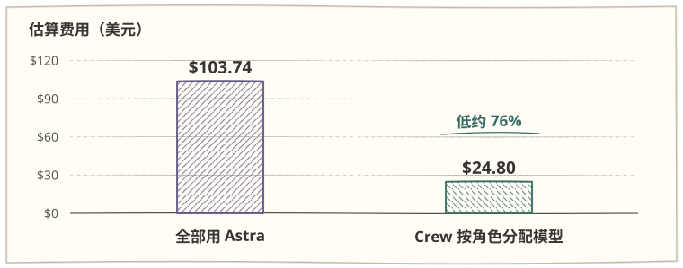

| 执行角色 | 智能体标识 | 实际模型 | 请求数 | 输入 Token（含缓存命中） | 输出 Token（含推理） | Token 占比 | 标准 API 估算费用 |
| --- | --- | --- | ---: | ---: | ---: | ---: | ---: |
| 主会话（日常调度） | 主会话 | `gpt-6.1-sol` | 164 | 25,828,289（缓存 25.47M） | 38,767 | 31.0% | \$3.79 |
| 后端开发（写业务与修复） | `crew_backend` | `gpt-6.1-sol` | 108 | 20,486,514（缓存 20.15M） | 45,348 | 24.6% | \$3.00 |
| 架构师（独立审查） | `crew_architect` | `gpt-6-astra` | 65 | 11,744,815（缓存 11.35M） | 16,849 | 14.1% | \$16.16 |
| 操作员（启服务与跑验收） | `crew_operator` | `gpt-6.1-terra` | 127 | 25,247,190（缓存 24.82M） | 33,455 | 30.3% | \$1.84 |
| **合计（Crew 分工）** | **4 角色协作** | **Astra + Sol + Terra** | **464** | **83,306,808（缓存率 98.2%）** | **134,419** | **100%** | **\$24.80** |
| *对照：若全按 Astra 计价* | *未分流基准* | *全部按 `gpt-6-astra` 算* | *464* | *83,306,808（同等缓存）* | *134,419* | *100%* | ***\$103.74*** |

按 [OpenAI 标准 API 价目表](https://developers.openai.com/api/docs/pricing) 换算（每百万 Token 未缓存输入 / 缓存输入 / 输出：Astra 为 `$10 / $1 / $40`，Sol 为 `$1.25 / $0.125 / $5`，Terra 为 `$0.40 / $0.04 / $1.60`）：

1. **85.9% 的活真正分流给了高性价比模型**：主会话本身用 `Sol` 做轻量调度，不再耗费旗舰额度；`Sol`（占 55.6% 用量）和 `Terra`（占 30.3% 用量）合计扛下了八成以上的工作量，加起来只花了 **\$8.63（占总费用的 34.8%）**。
2. **旗舰模型只花在刀刃上**：`Astra` 的 Token 占比从以前靠提示词软约束时的 **79.6%~92%** 压到了 **14.1%**，只负责 65 次高价值的独立架构与边界审查。
3. **跨角色协作不再靠长文传话烧额度**：各角色通过本地版本化状态直接读写决策与证据，配合高达 **98.2%** 的缓存命中率，同一批请求的账单从 **\$103.74 降到了 \$24.80，省了约 76.1%**。

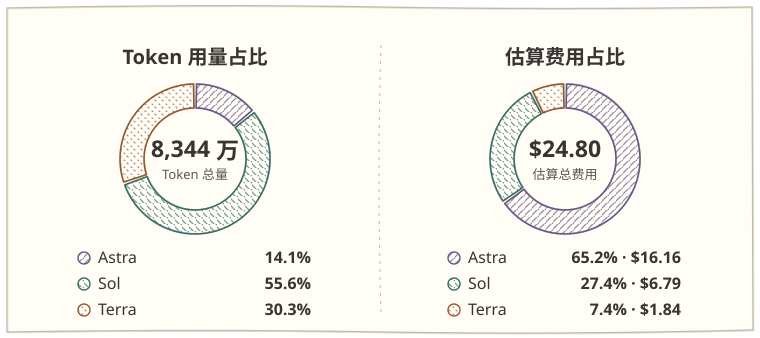

## 二、它具体能帮你做什么

1. **给每个角色固定模型和思考强度**
   自带协调（`coordinator`）、实现（`implementer`）、审查（`reviewer`）、研究（`researcher`）、测试（`tester`）5 个中英双语模板，也可以自己新建（比如上面的 `backend`、`architect`、`operator`）。每个角色单独设模型 ID 和思考强度，预览没问题后一键导出到 `.codex/agents/` 或 `.claude/agents/`。
2. **子智能体交接时不重复塞完整上下文**
   多角色协作或者新开会话接手时，最怕把前因后果再喂一遍。Crew 在本地用 SQLite 存了一份带版本号的任务状态（目标、约束、已敲定的决定、进度、下一步和验证证据）。第一次读快照，后面只用 `--since <版本号>` 读增量变化。实测跑 30 轮交接，增量读取比每轮重传完整状态能**少传约 76.3% 的状态数据（`118.9 KB → 28.2 KB`）**，并且带乐观锁，多个角色同时写也不会互相覆盖。
3. **Codex 和 Claude Code 都能用**
   两个宿主共用同一套 `crew` 命令和终端界面，但各自的角色配置和任务库是分开存的，不会串台。只依赖 Python 3.11+ 标准库，不联网、不碰你的账号凭证，也不保存聊天原文。

## 三、支持平台与终端界面

| 宿主 | 系统 | 本地加载方式 | 导出目录 |
| --- | --- | --- | --- |
| Codex | macOS、Linux | 在支持本地插件的 Codex 中添加 Crew 目录或导入 ZIP | `.codex/agents/crew-*.toml` |
| Claude Code | macOS、Linux | 用 `--plugin-dir` 启动，或登记为本地插件市场 | `.claude/agents/crew-*.md` |

需要 Python 3.11+。CLI、终端菜单和预设提示词都支持简体中文和英文，可以用 `--lang zh` 或 `--lang en` 切换。

平时不想记命令的话，直接跑 `crew tui` 就能打开终端菜单，在里面改角色、跑初始化向导、导出配置或者查看当前任务状态：

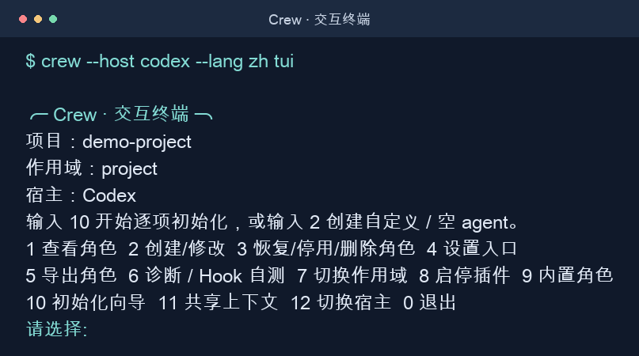

## 四、快速上手

### 1. 在 Codex.app 中导入与初始化（推荐）

如果你用的是 `Codex.app` 桌面端，不需要记任何终端命令，直接上传插件包就能在聊天框里交互式完成配置：

1. **打开插件页**：从 [GitHub Releases](https://github.com/Eki-Raku/crew/releases/latest) 下载 `crew.zip`，打开 `Codex.app` 左侧边栏的「插件」入口。

   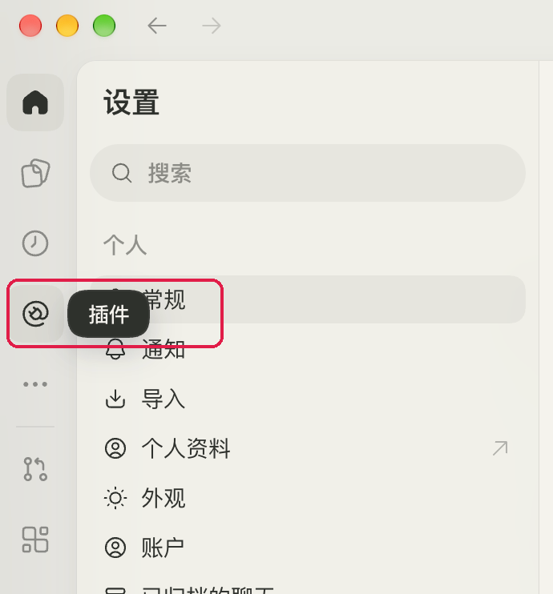

2. **选择上传插件压缩包**：点击右上角的「添加」按钮，在下拉菜单里选「上传插件压缩包」。

   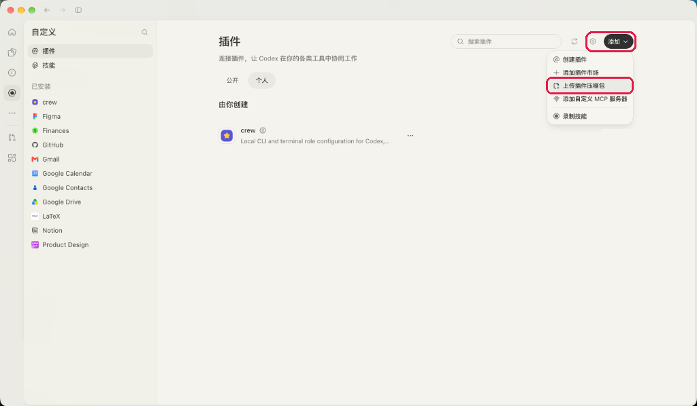

3. **上传 `crew.zip`**：在弹窗里选择刚才下载的 `crew.zip`，点击「添加插件」。

   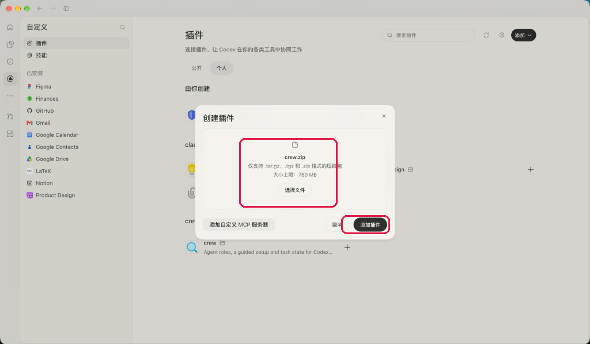

4. **安装插件**：进入 `crew` 插件详情页，点击右上角的「+ 安装插件」（若提示开启 Hook 请一并允许）。

   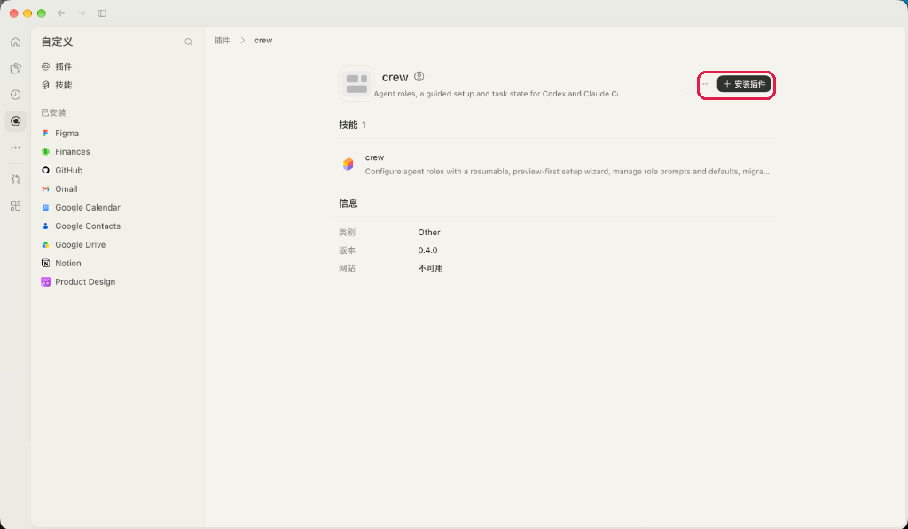

5. **一键进入设置**：安装完成后会弹出就绪提示，直接点击「设置 crew」。

   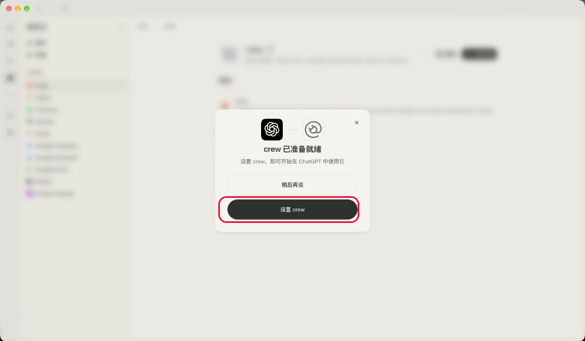

6. **在对话里完成角色初始化**：点击后会自动在聊天框填入「用 `crew` 技能帮助我设置 `@crew`」。选好你的项目目录直接发送，Codex 就会一步步问你需要哪些角色、分别用什么模型和思考强度，你确认预览后它会自动导出到 `.codex/agents/`。

   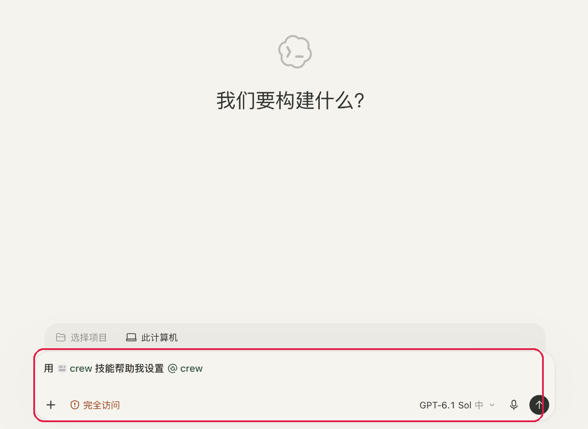

7. **日常按角色点名干活**：配置好之后，平时在对话里直接点名即可，比如输入：「请启动 `crew_reviewer`，检查这次改动是否引入回归」。

   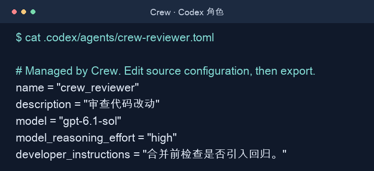

### 2. 用终端命令行初始化（Codex CLI）

如果你习惯在终端操作，也可以把仓库解压后直接在项目目录跑交互式向导：

```sh
python3 /路径/crew/bin/crew --host codex --lang zh init --interactive
python3 /路径/crew/bin/crew --host codex export
python3 /路径/crew/bin/crew --host codex export --apply
```

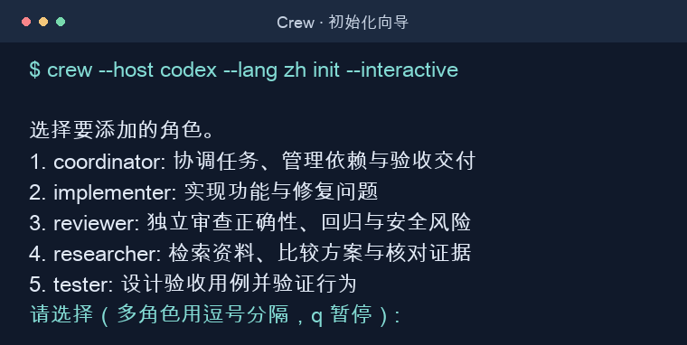

### 3. Claude Code

1. 在项目目录启动 Claude Code，用 `--plugin-dir` 指向下载的 ZIP 或解压目录（见 [Claude Code CLI 文档](https://code.claude.com/docs/en/cli-reference)）：

   ```sh
   claude --plugin-dir /路径/crew.zip
   ```

2. 在同一个项目目录用 CLI 配好角色并导出，之后在对话里直接叫 `crew-reviewer` 这类角色即可：

   ```sh
   python3 /路径/crew/bin/crew --host claude --lang zh init --interactive
   python3 /路径/crew/bin/crew --host claude export
   python3 /路径/crew/bin/crew --host claude export --apply
   ```

## 五、我自己的省钱配队方案

如果你也想复现上面省下 76% 费用的效果，初始化的时候可以参考这套三档模型的分法：

| 角色定位 | 角色名举例 | 模型档位（以 GPT 系列为例） | 思考强度 | 平时怎么用 |
| --- | --- | --- | --- | --- |
| 架构与把关 | `architect` / `reviewer` | 旗舰档（`gpt-6-astra`） | `high` / `xhigh` | 只在定方案、查疑难杂症、最后独立代码审查时叫出来，调用少但把关严 |
| 主力写代码 | `coordinator` / `implementer` / `backend` | 主力档（`gpt-6.1-sol`） | `medium` / `high` | 负责主会话调度和写具体业务代码，单价只有旗舰的 **1/8**，日常完全够用 |
| 跑腿与验收 | `tester` / `operator` / `researcher` | 轻量档（`gpt-6.1-terra`） | `low` / `medium` | 负责启停服务、跑全量测试、真实界面/数据库验收和查文档，单价只有旗舰的 **1/25**，高频调也不心疼 |

关于 Codex 全局入口配置、Claude Code 本地市场安装、自定义角色提示词以及多会话交接的具体命令，都整理在 [Cookbook](docs/COOKBOOK.md) 里了。

## 六、常见问题

**需要填 API Key 或注册账号吗？**

不需要。Crew 只是在本地生成角色配置、维护 SQLite 任务状态，自己不发任何模型请求。模型鉴权和额度都走你原本的 Codex 或 Claude Code。

**能改提示词、自己加角色或者换别的模型吗？**

可以。你可以直接改预设，也可以用 `crew role create <名称>` 建新角色。模型 ID 和思考强度只要你的宿主客户端支持就能填。

**Codex 和 Claude Code 的任务状态会互通吗？**

不会，两边各自保存自己的角色配置和任务数据库，互不干扰。共享任务状态是用在同一个宿主的不同会话和子智能体之间的。

**Crew 会自动切换主会话的模型吗？**

不会，导出的模型设置只管子智能体。主会话用什么模型还是在宿主里选（我一般把主会话也设成 `gpt-6.1-sol` 来做日常调度）。

## 七、安全、升级与验证

角色仅支持 `model`、`effort`、`description`、`instructions`、`disabled`。未实现的字段会明确拒绝，包括 Claude 的工具/权限控制；需要这些控制的 agent 请在 Crew 之外维护，不要为了导出而删掉权限限制。受管理配置、导出及 SQLite 文件不允许使用符号链接。

手工共享任务命令请明确传入 `--host`；显式 `--provider` 必须与它一致。Hook 返回带当前 Python、插件路径、宿主和项目的命令，`doctor` 显示版本与插件目录。

升级前停止 Hook 写入并备份各宿主 Crew 数据、项目配置和导出，再预览新导出。源码更新不会自动替换已有 release ZIP。[备份、升级与回退](docs/COOKBOOK.md#备份升级与回退) · [变更记录](CHANGELOG.md)

独立测试命令：`python3 -m unittest discover -s tests -v`。CI 覆盖 Linux/macOS、Python 3.11/3.14，并验证归档结构；测试不启动真实宿主或模型。宿主加载、Hook 信任和模型可用性仍需单独验收，当前不声明已验证的宿主版本。
